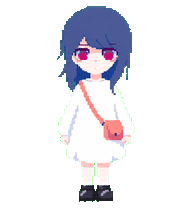

# Hal — UNREAL LIFE

以《UNREAL LIFE》的角色 Hal（ハル）为原型制作的 Codex／ChatGPT Work v2 动画宠物。

## 发布资源

- `assets/spritesheet-v2.png`：可直接导入的 v2 精灵表。
- `pet.json`：尺寸、帧数、状态顺序、文件校验值及已上传宠物 ID。
- `previews/`：全部状态、视线方向和跳跃动作的动态预览。
- `qa/`：最终联系表、方向检查图和验证摘要。

## 精灵表规格

- 图像尺寸：1536 × 2288 px
- 网格：8 列 × 11 行
- 单元格：192 × 208 px
- 格式：RGBA PNG
- 精灵版本：v2
- 动画状态：待机、左右奔跑、挥手、跳跃、失败、等待、工作、审阅
- 观察方向：16 个

## 文件组织原则

仓库只提交发布所需文件。生成过程中的中间帧、失败尝试、提示词、上传会话数据和下载的第三方参考图片保留在本地工程中，不进入公开仓库。

来源及权利说明见 [ATTRIBUTION.md](ATTRIBUTION.md)。

